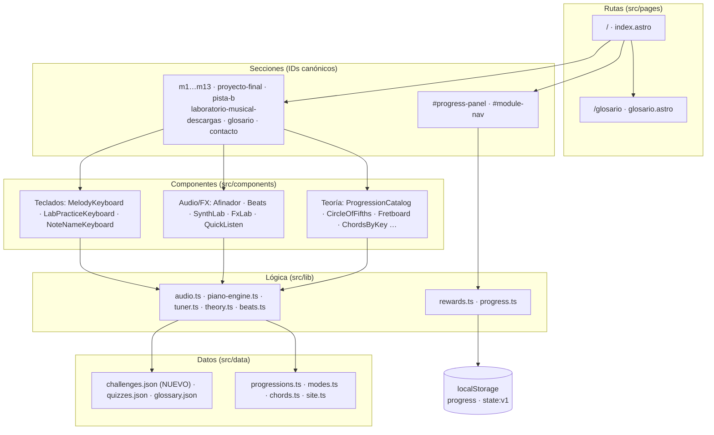

Actúa como Tech Lead, Diseñador UI/UX Senior (especialista en microinteracciones y accesibilidad para TDAH) y Desarrollador Frontend en Astro. Vamos a implementar la **ETAPA 1: El Motor de Retos Gamificados** para la aplicación **Progressive Music**, asegurando un diseño impecable y cero sensaciones de "trabajo escolar".

### 0. Mapa / Esquema de la App (referencia obligatoria)

Antes de tocar código, este es el mapa **real** del proyecto. Úsalo para ubicar cada archivo y conectar el Motor de Retos sin duplicar lógica existente. Los IDs y las claves de abajo son canónicos: **no renombrarlos**.

**Stack:** Astro 5 (output estático) · TypeScript strict · CSS global con variables (`src/styles/global.css`: `--bg`, `--card`, `--bd`, `--acc`, `--fg`, `--mut`) · Web Audio API · Vitest + scripts `.mjs` · despliegue estático en Vercel (`dist/`). No hay backend: todo corre en el cliente.

#### 0.1 Árbol de fuentes
```
src/
├── pages/
│   ├── index.astro        # Página principal: hero + secciones (M1–M13, Proyecto, Pista B, Lab, Glosario, Contacto)
│   └── glosario.astro     # Página del glosario completo
├── layouts/
│   └── Layout.astro       # Shell HTML, tema (dataset.theme) y delegación global de clics → views.renderChordView
├── components/            # Componentes .astro (islas con <script> propio)
├── lib/                   # Lógica de dominio / infra (ver 0.4)
├── data/                  # Catálogos estáticos (ver 0.5)
└── styles/global.css      # Tokens + glassmorphism + modo claro/oscuro
public/                    # quizzes.json, glossary.json, favicon, og-image, sitemap
```

#### 0.2 Rutas
| Ruta | Archivo | Contenido |
|---|---|---|
| `/` | `src/pages/index.astro` | Toda la app en una sola página (hero, índice de módulos, módulos, panel de progreso, laboratorio, contacto) |
| `/glosario` | `src/pages/glosario.astro` | Glosario navegable |
| `/quizzes.json`, `/glossary.json` | `public/` | Copias estáticas servidas tal cual |

#### 0.3 Mapa de secciones de `index.astro` (IDs canónicos)
Cada `<section>` lleva `id` y `data-module` (salvo excepciones). Estos IDs son la clave para enrutar retos y marcar progreso.

| ID | Módulo / sección | Componentes dentro | Toggle de progreso |
|---|---|---|---|
| `m1` | M1 · Sonido y pulso | `SoundPropertiesExplorer` | `data-module-toggle="m1"` |
| `m2` | M2 · Notas, teclado y cifrado | `EmptyStaff`, `NoteNameKeyboard` | `m2` |
| `m3` | M3 · Tonos, semitonos, escala mayor e intervalos | `IntervalExplorer`, `InteractiveIntervalTable`, `ScaleTable`, `ChordsByKey` | `m3` |
| `m4` | M4 · Tríadas y primeros acordes | `Afinador`, `Fretboard` | `m4` |
| `m5` | M5 · Grados y funciones | `BaseChords` | `m5` |
| `m6` | M6 · Primeras progresiones | `Transposer`, `QuickListen`, `ProgressionCatalog`, `Tips` | `m6` |
| `m7` | M7 · Séptimas y cifrado ampliado | (texto + cajas) | `m7` |
| `m8` | M8 · Cadencias, forma y melodía | (texto + cajas) | `m8` |
| `m9` | M9 · Inversiones y arpegios | `Inversions`, `Exercise` | `m9` |
| `m10` | M10 · Menor, modos e intercambio modal | `Emotions` | `m10` |
| `m11` | M11 · Círculo de quintas | `CircleOfFifths` | `m11` |
| `m12` | M12 · Dominantes secundarias | `ProgressionCatalog` (avanzado) | `m12` |
| `m13` | M13 · Ritmo por género | `Beats` | `m13` |
| `proyecto-final` | Proyecto Final · Compón tu canción | (texto) | `proyecto-final` |
| `pista-b` | Pista B · Producción y DAW | `FxLab`, `SynthLab` | `pista-b` |
| `laboratorio-musical-descargas` | Laboratorio musical y descargas | `LabPracticeKeyboard` | — (sin toggle) |
| `glosario` | Glosario (enlace a `/glosario`) | modal `#glossary-modal` | — |
| `contacto` | Contacto y cafecito | SVG + tarjetas | — |

Otros anclajes fuera de los módulos: `#progress-panel` (panel "Mi progreso": nivel, barra XP, XP, insignias, módulos completados, `#sound-toggle`, `#reset-progress`), `#module-nav` (índice de módulos), `.keyboard-showcase` (`MelodyKeyboard` de demo en el hero) y `Nav.astro` (navegación lateral por `data-go`).

#### 0.4 Mapa de librerías (`src/lib/`)
| Archivo | Responsabilidad | Exports clave para el Motor de Retos |
|---|---|---|
| `progress.ts` | Persistencia por módulo | `readProgress`, `writeProgress`, `setModuleProgress`, `getModuleProgress`, `isModuleCompleted`, `PROGRESS_KEY` |
| `rewards.ts` | XP, nivel, racha, insignias y sonido | `readRewardState`, `writeRewardState`, `getLevel`, `awardQuestionXp(id, attempt, isAural, isPlay)` (+10 al 1.er intento, +5 al 2.º, solo la 1.ª vez), `awardModuleBonus`, `breakStreak`, `playSuccessSound`, `resetRewardState`, `LEVELS` |
| `tuner.ts` | Detección de altura por micrófono | `createPitchDetector`, `centsBetween`, `nearestMidiForPitchClass`, `foldToReference`, `noteName`, `PitchReading` |
| `piano-engine.ts` | Motor de teclado (QWERTY, sustain) | `noteOn`, `noteOff`, `setSustainPedal`, `playNote`, `playPiano` |
| `audio.ts` | Web Audio: síntesis, FX y reproducción | `audioContext`, `scheduleTone`, `playChord`, `playSequence`, `playPiano`, `playMelody`, `PRESETS` |
| `theory.ts` | Acordes, escalas e intervalos | `parseChord`, `chordNotes`, `diatonicChords`, `INTERVALS`, `pitchClass`, `degreeToChord`, `keyboardSvg` |
| `beats.ts` | Scheduler rítmico | `stepTime`, `patternToFigures`, `barDuration` |
| `views.ts` | Render de acordes en el DOM | `renderChordView` |
| `finger-practice.ts` | Validación de digitación | `validateFingerPractice` |
| `dom.ts` | Helpers de DOM | `$`, `$$`, `must` |

#### 0.5 Mapa de datos (`src/data/`)
| Archivo | Formato | Uso |
|---|---|---|
| `quizzes.json` | JSON | Prueba de nivel (`placement.questions`) y banco existente: `id`, `type`, `prompt`, `options[{id,text}]`, `correct`, `explanation`, `hint`, `level`, `reviewAnchor` |
| `glossary.json` | JSON (`entries[]`) | `term`, `definicion`, `ingles`, `categoria`, `verificar` |
| `progressions.ts`, `modes.ts`, `chords.ts`, `beats.ts`, `glossary.ts`, `site.ts` | TS | Catálogos y constantes del sitio (`SITE_NAME`, `SITE_URL`, etc.) |
| **`challenges.json`** | JSON | **NUEVO en Etapa 1** — retos con `id`, `modulo`, `tipo`, `enunciado`, `opciones`, `validacion`, `pista`, `explicacion`, `entrada` |

#### 0.6 Puntos de integración del Motor de Retos (Etapa 1)
1. **Lanzamiento:** botón en cada `<section data-module="mX">` (o en `#progress-panel`) que abra el `ChallengeModal` filtrando retos por `modulo`.
2. **Validación / XP:** reutiliza `awardQuestionXp()` y `playSuccessSound()`; `breakStreak()` al fallar. Nunca mostrar la palabra "incorrecto".
3. **Entrada `ver_tocar`:** teclado demo (`MelodyKeyboard` / `LabPracticeKeyboard`) + `piano-engine.ts`; MIDI vía `navigator.requestMIDIAccess()` (Fase 1.3 del roadmap, aún pendiente).
4. **Entrada `tocar_validar`:** `tuner.ts` (`createPitchDetector` + `centsBetween`, tolerancia ±30 cents); fallback automático al teclado si no hay permiso de micrófono. Aviso: el audio se procesa localmente y no sale del dispositivo.
5. **Finalización:** al cerrar la sesión con ≥70% de aciertos, `setModuleProgress(id, { completed: true })` + `awardModuleBonus(id, perfect)`. **Eliminar** los `<label class="progress-toggle">` actuales de "Marcar módulo como completado".
6. **Persistencia:** `localStorage` (ver 0.7); el modal guarda la sesión al pulsar "Terminar por hoy".

#### 0.7 Claves de `localStorage`
| Clave | Origen | Contenido |
|---|---|---|
| `progressive-music:progress` | `progress.ts` | `{ [moduleId]: { completed, score?, updatedAt } }` |
| `progressive-music:state:v1` | `rewards.ts` | `{ xp, streak, maxStreak, auralCorrect, playCorrect, awardedQuestions[], awardedModules[], badges[], soundEnabled }` |
| `progressive-music:glossary-modals` | `index.astro` | `'1'` / `'0'` (modal de glosario activo) |
| `document.documentElement.dataset.theme` | `index.astro` | `'dark'` / `'light'` (tema) |

#### 0.8 Diagrama del mapa


---

### 1. Directrices de Diseño y Estética (OBLIGATORIO)
- **Mantener el ADN Visual:** Respeta estrictamente la paleta actual (Dark mode, fondos oscuros profundos, tarjetas con efecto *Glassmorphism* usando `-webkit-backdrop-filter: blur(10px)` y `backdrop-filter: blur(10px)`, bordes semitransparentes sutiles y tipografías limpias).
- **Enfoque TDAH & Inmersión:** 
  - Cero scroll en la pantalla de retos. Todo debe caber en el viewport ("Viewport-fit").
  - Botones extra grandes, áreas táctiles amplias y retroalimentación inmediata visual y sonora.
  - **Modo Enfoque:** Añade un botón flotante que oculte toda la decoración de fondo, barras laterales y menús, dejando únicamente el reto activo en pantalla.

---

### 2. Arquitectura de Datos (`src/data/challenges.json`)
Crea un archivo JSON inicial con al menos 5 retos de prueba (para M1, M2 y M3) siguiendo esta estructura estricta:
```json
{
  "id": "m1_reto_01",
  "modulo": "M1",
  "tipo": "oir_elegir", 
  "enunciado": "¿Qué propiedad del sonido determina si es más agudo o grave?",
  "opciones": ["Altura", "Duración", "Intensidad", "Timbre"],
  "validacion": "Altura",
  "pista": "Piensa en una sirena subiendo y bajando de frecuencia.",
  "explicacion": "La altura mide la frecuencia de vibración en Hertz (Hz).",
  "entrada": "pantalla"
}

Para lograr exactamente lo que buscas —convertir **Progressive Music** en un juego de aprendizaje adictivo, fluido, pensado para mantener la atención (incluso con TDAH) y **respetando al 100% la estética Dark Glassmorphism elegante** que ya tienes—, vamos a estructurarlo como un **Super Prompt de Arquitectura e Interfaz**.

Este prompt está diseñado para que tu agente no haga las cosas "a medias", sino que construya una **Etapa 1 (Motor de Retos)** robusta, hermosa, sin scroll, con animaciones fluidas y conectada directamente a tus componentes existentes (teclado, afinador por micrófono y MIDI).

---

### Copia y pega el siguiente prompt maestro en tu agente:

```markdown
Actúa como Tech Lead, Diseñador UI/UX Senior (especialista en microinteracciones y accesibilidad para TDAH) y Desarrollador Frontend en Astro. Vamos a implementar la **ETAPA 1: El Motor de Retos Gamificados** para la aplicación **Progressive Music**, asegurando un diseño impecable y cero sensaciones de "trabajo escolar".

### 1. Directrices de Diseño y Estética (OBLIGATORIO)
- **Mantener el ADN Visual:** Respeta estrictamente la paleta actual (Dark mode, fondos oscuros profundos, tarjetas con efecto *Glassmorphism* usando `-webkit-backdrop-filter: blur(10px)` y `backdrop-filter: blur(10px)`, bordes semitransparentes sutiles y tipografías limpias).
- **Enfoque TDAH & Inmersión:** 
  - Cero scroll en la pantalla de retos. Todo debe caber en el viewport ("Viewport-fit").
  - Botones extra grandes, áreas táctiles amplias y retroalimentación inmediata visual y sonora.
  - **Modo Enfoque:** Añade un botón flotante que oculte toda la decoración de fondo, barras laterales y menús, dejando únicamente el reto activo en pantalla.

---

### 2. Arquitectura de Datos (`src/data/challenges.json`)
Crea un archivo JSON inicial con al menos 5 retos de prueba (para M1, M2 y M3) siguiendo esta estructura estricta:
```json
{
  "id": "m1_reto_01",
  "modulo": "M1",
  "tipo": "oir_elegir", 
  "enunciado": "¿Qué propiedad del sonido determina si es más agudo o grave?",
  "opciones": ["Altura", "Duración", "Intensidad", "Timbre"],
  "validacion": "Altura",
  "pista": "Piensa en una sirena subiendo y bajando de frecuencia.",
  "explicacion": "La altura mide la frecuencia de vibración en Hertz (Hz).",
  "entrada": "pantalla"
}

```

*(Tipos de retos soportados: `oir_elegir`, `ver_tocar` usando el teclado existente, `tocar_validar` usando el micrófono del afinador).*

---

### 3. Componente de Sesión Interactiva (`ChallengeModal.tsx` o `.astro` con isla React)

Construye una vista de sesión a pantalla completa que contenga:

1. **Barra de Progreso Animada:** Un indicador visual de 5 a 8 pasos limpia y minimalista, situada en la parte superior.
2. **Botón de Escape Constante:** Un botón superior visible en todo momento que diga "Terminar por hoy" y guarde el progreso actual en `localStorage`.
3. **Mecánica de Validación y XP:**
* Si acierta al **primer intento**: +10 XP y animación de acierto sutil con partículas o destello.
* Si acierta al **segundo intento**: +5 XP. El XP solo se otorga la primera vez que se supera el reto.
* Si falla: **Nunca muestres la palabra "incorrecto"**. Cambia el texto dinámicamente a **"Casi 🎹 — [Respuesta correcta] + [Explicación breve de 2 frases]"**. Tras 2 fallos, se desbloquea automáticamente el botón de "Ver Pista".


4. **Sistema de Repetición Espaciada Simple:** Los retos fallados se vuelven a encolar al final de la misma sesión para afianzar el aprendizaje. El módulo solo se marca como completado al terminar la sesión con $\ge 70\%$ de aciertos. Elimina cualquier botón estático anterior de "Marcar módulo como completado".

---

### 4. Integración con Entradas Reales (Reutilizando herramientas previas)

* **Modo Micrófono (Afinador):** Para retos del tipo `tocar_validar`, integra la lógica de detección de altura existente (tolerancia de $\pm30$ cents). Muestra un indicador visual de confianza de la señal. *Nota de seguridad:* Añade un aviso sutil de que el audio se procesa localmente en el navegador y no se graba ni sale del dispositivo. Si el micrófono falla o no hay permisos, haz un fallback automático al teclado en pantalla.
* **Modo Teclado / MIDI:** Conecta el teclado virtual existente y la Web MIDI API (`navigator.requestMIDIAccess`) para que los retos de tocar notas validen de inmediato lo que el usuario presiona en su teclado físico o pantalla.

---

### 5. Ajustes Rápidos Accesibles

Incluye un panel colapsable de ajustes rápidos con:

* Interruptor de Sonido (On/Off).
* Reducir movimiento (`prefers-reduced-motion`).
* Selector de entrada preferida (`Pantalla` | `Micrófono` | `MIDI`).

Implementa esta Etapa 1 completa, asegúrate de que compile sin errores en Astro, pruébala localmente y entrégame la lista de archivos modificados junto con el reporte de lo que ya se ve en producción.

```

---

### ¿Por qué este enfoque destruye cualquier sensación de "manual aburrido"?
1. **Gamificación psicológica:** Elimina el castigo ("incorrecto") y lo sustituye por una guía amigable ("casi"), reduciendo la frustración en personas con TDAH o principiantes absolutos.
2. **Reutiliza tu código:** En lugar de rehacer el afinador o el teclado, los convierte en los **controles del juego**. Tocar un teclado virtual o cantar al micrófono se vuelve el joystick con el que respondes los retos.
3. **Cero fricción visual:** Al ocultar todo mediante el *Modo Enfoque* y eliminar el scroll, el usuario solo ve un reto a la vez, lo que evita la fatiga mental y maximiza la retención.

```

---

## ETAPA 2 · Retos de M1 a M3 — COMPLETADA

**Banco:** 23 retos (M1: 8 · M2: 7 · M3: 8). Los 15 nuevos se reparten 5 por módulo y cubren `oir_elegir`, `ver_tocar`, `tocar_validar` y el nuevo `tocar_pulso`.

**Nuevo tipo `tocar_pulso`:** patrón `{ bpm, golpes, toleranciaMs? }` en `challenges.json` + validación pura en `src/lib/challenges.ts` (`pulseTimes`, `pulseInterval`, `pulseTolerance`, `isPulseOnTime`, `isPulsePassed`). La UI usa Web Audio para el metrónomo y acepta Espacio, botón grande, teclado QWERTY y MIDI. El botón 🔊 reinicia el metrónomo.

**Sesión:** la barra se recalcula por módulo (8/7/8 segmentos); se mantienen XP +10/+5, pista tras 2 fallos, mensaje `Casi 🎹 — [Respuesta] + [Explicación]`, repetición espaciada, ≥70% para completar y modo enfoque.

**Archivos tocados:** `src/data/challenges.json`, `src/lib/challenges.ts`, `src/components/ChallengeSession.astro`, `tests/challenges.test.ts`, `tests/challenges.browser.mjs`, `AGENT.md`.

**Verificación:** `pnpm test` 37/37 · `pnpm build` OK · `pnpm test:browser:challenges` OK · `pnpm test:browser:tuner` OK. El fallo preexistente de `pnpm test:browser` (chords-by-key) se resolvió al final de la Etapa 3B actualizando las aserciones al título `El molde de la escala`.

---

## ETAPA 3 · Retos pendientes M4–M13 — COMPLETADA

**Banco final:** 73 retos (M1: 8 · M2: 7 · M3: 8 · M4–M13: 5 cada uno). Los 50 nuevos priorizan la entrada real: **17 `tocar_validar` con micrófono del afinador** y **19 `ver_tocar` con MIDI/teclado**, más 10 `oir_elegir` y 4 `tocar_pulso` de refuerzo rítmico.

**Contenido por módulo:** M4 tríadas · M5 grados y funciones · M6 progresiones · M7 séptimas · M8 cadencias y forma · M9 inversiones y arpegios · M10 menor y modos · M11 círculo de quintas · M12 dominantes secundarias · M13 ritmo por género.

**Sesión:** todo reto de nota muestra ahora **ambos controles** (🎤 micrófono y 🎹 MIDI), conmutables desde «Entrada preferida» en ajustes rápidos. El fallback QWERTY sigue disponible. La barra ajusta automáticamente los 5 segmentos de cada módulo nuevo.

**Archivos tocados:** `src/data/challenges.json`, `src/components/ChallengeSession.astro`, `tests/challenges.test.ts`, `tests/challenges.browser.mjs`, `tests/tuner.browser.mjs`, `AGENT.md`.

**Nota E2E:** `tests/tuner.browser.mjs` esperaba 500 ms fijos a que el módulo ES de `Afinador.astro` generara las 6 cuerdas; en arranques fríos de Vite eso bastaba solo a veces (`0 !== 6`). Se añadió un bucle de reintento igual al de `challenges.browser.mjs`. No había ninguna regresión en el afinador: el script generaba las cuerdas justo después.

**Verificación:** `pnpm test` 38/38 · `pnpm build` OK · `pnpm test:browser:challenges` OK · `pnpm test:browser:tuner` OK (ambos E2E ejecutados dos veces). El fallo preexistente de `pnpm test:browser` (chords-by-key) se resolvió al final de la Etapa 3B.

---

## ETAPA 3B · Biblioteca de Melodías y Práctica MIDI — COMPLETADA

**Stack:** se añade Preact 11 + `@astrojs/preact` (integración `preact()` en `astro.config.mjs`, `jsx: "react-jsx"` y `jsxImportSource: "preact"` en `tsconfig.json`). El resto del sitio sigue siendo Astro estático sin backend. La biblioteca vive en M8, justo después de la explicación de cadencias.

**Catálogo modular:** `src/data/melodies/` con un JSON por pieza (`twinkle`, `ode`, `silent-night`, `pop-loop`, `minuet`) y un `index.ts` que los descubre con `import.meta.glob('./*.json', { eager: true })`, ordena por el campo `order` y lo elimina del objeto exportado. **Para añadir una melodía basta con crear un JSON nuevo en esa carpeta: no hay que tocar ningún archivo existente.** Cada pieza tiene `id`, `title`, `difficulty` (Principiante/Intermedio), `bpm`, `meter`, `key`, `melodyTrack` (notas con `beat`, `midi`, `duration`, `label`) y `chordTrack` (bloques con `symbol` y `midi[]`). Todas las alturas están en C4–Mi5 (MIDI 60–79) para cubrirse con dos octavas QWERTY. `MELODY_CATALOG_VERSION` se exporta desde el agregador.

**Audición «cómo suena»:** cada tarjeta del menú (y el selector de modo) tiene un botón **▶ Cómo suena / ■ Detener**. `auditionEvents(melody)` convierte la pieza en eventos para `playPiano`: melodía al frente (vel. 0,85, `focus: true`) y acordes una octava más graves y suaves (vel. 0,4), al BPM propio del JSON. **Suena una sola vez y se detiene sola al terminar** —es una referencia para el oído, no un bucle; el bucle es solo de la práctica—. El botón permite cortarla en cualquier momento y se cancela automáticamente al elegir pieza, entrar a practicar o volver al menú. Mientras suena, una ventana de 12 notas y una barra de progreso siguen la melodía. No requiere archivos de audio: se sintetiza desde los mismos datos modulares.

**Selector de modo:** pantalla previa con **Practicar Melodía** (nota por nota, octava exacta) y **Practicar Acordes** (un bloque armónico por compás, en simultáneo o arpegio guiado). La entrada acepta QWERTY (`Z–M` = 60–71, `Q–T`/números = 72–79), pantalla táctil y Web MIDI (`navigator.requestMIDIAccess()`, eventos `noteon`).

**Motor y validación:** `src/lib/melodies.ts` concentra la lógica pura: `matchesNote` (exige MIDI exacto, octava incluida), `matchesChord` (compara clases `midi % 12`, válido en cualquier octava), `rhythmAccuracy` (tolerancia de 2 pulsos), `evaluatePerformance` (70 % melodía + 30 % ritmo; XP base 25/40 + 10 por pieza perfecta; 1–3 estrellas), `eventAtBeat`, `trackLength` y `noteName`. Un fallo no avanza: muestra `Casi 🎹 — esperaba …` y el teclado marca la nota tocada en rojo; el acierto avanza y la marca en verde.

**Teclado en cascada:** resalta la nota esperada, atenúa las tres siguientes y resalta las notas tocadas. El metrónomo usa Web Audio y muestra puntos por pulso (`#ml-beat`) sincronizados al BPM; el feedback de tempo indica `En hora ✓` o `Adelantado|Atrasado X pulsos`. La práctica va **en bucle por defecto**: al terminar una vuelta `completeCycle()` reinicia el recorrido sin cortar el metrónomo y sube el contador de vuelta; solo **Detener** (`#ml-stop`) muestra el resultado y otorga XP. El toggle `#ml-loop` permite desactivar el bucle. Transporte con Play/Pausa, Detener, reinicio, BPM ±4 (50–180; cambiarlo a mitad de vuelta rearma el reloj) y Volver al menú. Estética Dark Glassmorphism con `color-mix`, `backdrop-filter`, animación de pulso y `prefers-reduced-motion`.

**Recompensas:** `awardPracticeXp(practiceId, xp)` en `src/lib/rewards.ts` entrega XP una sola vez por pieza/modo (`melody:<id>:<mode>`), suma `playCorrect`, desbloquea el badge **Melodista** y emite `progress:changed` para sincronizar el panel global.

**Archivos tocados:** `astro.config.mjs`, `tsconfig.json`, `package.json`, `pnpm-lock.yaml`, `src/components/MelodyLibrary.tsx`, `src/components/MelodyLibrary.astro`, `src/data/melodies/*.json` (5 piezas) + `src/data/melodies/index.ts` (se elimina `src/data/melodies.json`), `src/lib/melodies.ts`, `src/lib/rewards.ts`, `src/pages/index.astro`, `tests/melodies.test.ts`, `tests/melodies.browser.mjs`, `tests/challenges.browser.mjs` (reintentos anti-flakiness), `tests/chords-by-key.browser.mjs` (aserciones actualizadas al renombrado didáctico de commit `461ffaa`), `AGENT.md`.

**Nota E2E:** `tests/melodies.browser.mjs` recarga con CDP ya conectado (así captura errores de hidratación del island), espera a que la badge MIDI deje de decir «conectando…» y toca las notas en su pulso exacto mediante eventos QWERTY temporizados. Verifica 100 % de precisión, +50 XP por modo (Intermedio), idempotencia del XP, cascada, bucle automático (vuelta 2 sin detenerse), metrónomo visual, feedback de tempo, transporte y ausencia de errores de página. El resaltado de acierto/fallo dura 1,2 s: Preact confirma el render en `requestAnimationFrame`, que en Chrome headless puede tardar ~500 ms, y con 450 ms el test leía el DOM cuando la clase ya se había borrado. La audición se comprueba **al final** del test: crear osciladores antes de las mediciones de ritmo introduce jitter y volvía flaky el 100 % de precisión.

**Verificación final:** `pnpm test` 48/48 · `pnpm build` OK · `pnpm test:browser:melodies` OK · `pnpm test:browser:challenges` OK · `pnpm test:browser:tuner` OK · `pnpm test:browser` (chords-by-key) OK. El fallo preexistente de `chords-by-key` quedó resuelto actualizando las aserciones obsoletas al título **El molde de la escala** y a los `aria-label` con separador `·`; el test ahora espera al view dinámico `svg.kb` en lugar del título estático.