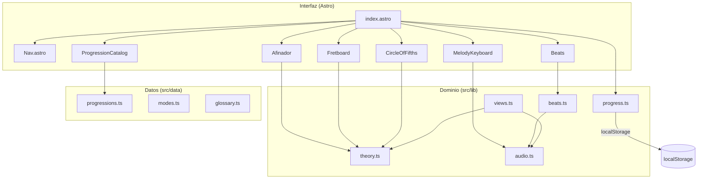
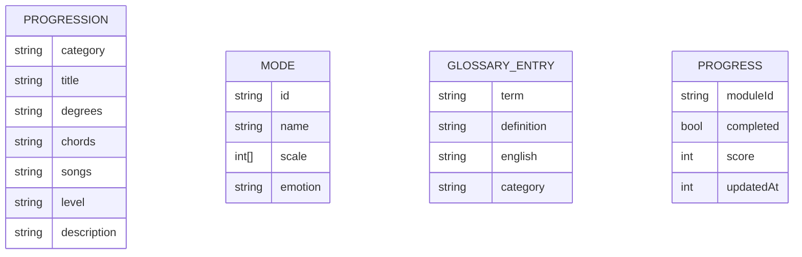
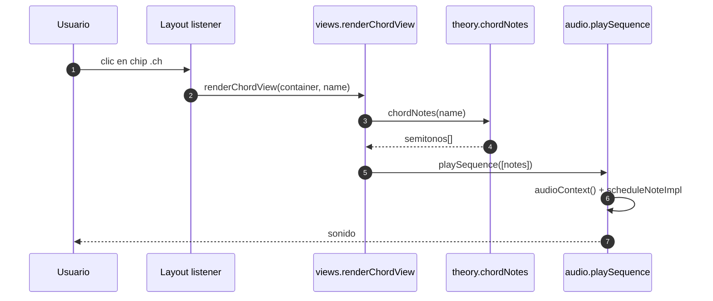
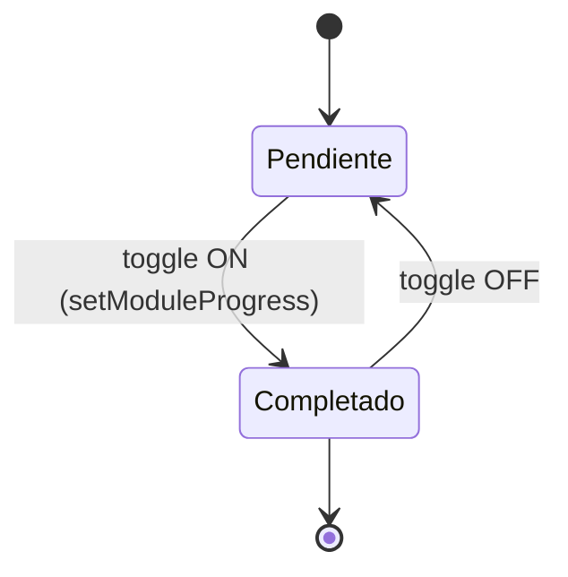

# Arquitectura de Progressive Music

## Resumen ejecutivo
Progressive Music es una app estática en Astro que entrega un manual interactivo
de teoría musical (piano/guitarra) con audio en tiempo real vía Web Audio API.
La UI se compone de componentes `.astro` con islas de JavaScript; la lógica de
teoría y audio vive en `src/lib`, y los datos del catálogo en `src/data`.
El progreso del usuario se persiste en `localStorage`.

## Stack tecnológico
- **Framework:** Astro 5.9 (output estático)
- **Lenguaje:** TypeScript (strict)
- **Estilos:** CSS global + variables (Tailwind no se usa en el build actual, pero las convenciones visuales se mantienen)
- **Audio:** Web Audio API nativa (`src/lib/audio.ts`)
- **Tests:** Vitest (unitarios) + scripts de navegador (`tests/*.mjs`)
- **Despliegue:** Vercel (estático, `dist/`)

## Patrón arquitectónico
Monolito estático con arquitectura por capas ligeras:
- **Presentación:** componentes Astro (`src/components`, `src/pages`).
- **Dominio/utilidades:** `src/lib` (theory, audio, beats, dom, tuner, piano-engine, views, progress).
- **Datos:** `src/data` (progressions, modes, chords, beats, site, glossary).
No hay backend; todo corre en el cliente.

## Tabla de componentes

| Componente / Módulo | Capa | Responsabilidad | Depende de | Ubicación |
|---|---|---|---|---|
| `index.astro` | Presentación | Página principal, secciones y módulos | Layout, Nav, componentes | `src/pages/index.astro` |
| `Layout.astro` | Presentación | Shell HTML, scripts globales de delegación | dom, theory, audio, views | `src/layouts/Layout.astro` |
| `Nav.astro` | Presentación | Navegación por secciones/módulos | — | `src/components/Nav.astro` |
| `MelodyKeyboard` | Presentación | Teclado interactivo de melodía | audio, theory | `src/components/MelodyKeyboard.astro` |
| `ProgressionCatalog` | Presentación | Catálogo filtrable de progresiones | progressions, audio | `src/components/ProgressionCatalog.astro` |
| `Afinador` | Presentación | Afinador cromático por micrófono | tuner | `src/components/Afinador.astro` |
| `Fretboard` | Presentación | Mástil de guitarra interactivo | theory | `src/components/Fretboard.astro` |
| `Beats` | Presentación | Secuenciador de ritmos | beats, audio | `src/components/Beats.astro` |
| `CircleOfFifths` | Presentación | Mapa de quintas | theory | `src/components/CircleOfFifths.astro` |
| `theory.ts` | Dominio | Parsing de acordes, escalas, diagramas | — | `src/lib/theory.ts` |
| `audio.ts` | Dominio/Infra | Web Audio: síntesis piano, FX, reproducción | — | `src/lib/audio.ts` |
| `beats.ts` | Dominio | Scheduler de patrones rítmicos | — | `src/lib/beats.ts` |
| `progress.ts` | Infra (cliente) | Persistencia de progreso en localStorage | window.localStorage | `src/lib/progress.ts` |
| `progressions.ts` | Datos | Catálogo de progresiones | — | `src/data/progressions.ts` |
| `modes.ts` | Datos | Definiciones de modos y melodías | — | `src/data/modes.ts` |
| `glossary.ts` | Datos | Glosario transversal | — | `src/data/glossary.ts` |

## Flujo de control general
1. Astro genera HTML estático en build (`pnpm build` → `dist/`).
2. En el navegador, `Layout.astro` registra un listener global de clics que
   delega a `renderChordView` para chips de acordes y reproducción de
   progresiones.
3. Los componentes hidratan sus propios `<script>` (vanilla TS compilado por Vite).
4. El audio se genera on-demand con `audioContext()` y nodos Web Audio; no hay
   autoplay.
5. El progreso se lee/escribe en `localStorage` bajo la clave
   `progressive-music:progress`.

## Diagrama de componentes

## Modelo de datos (catálogo)

## Flujos clave

### Reproducción de acordes (sequenceDiagram)

### Progreso de módulo (stateDiagram)

## Deuda técnica y riesgos
- **Sin backend:** toda la persistencia es local; no hay sincronización entre dispositivos. [Inferido]
- **Componentes con scripts duplicados:** cada `.astro` inyecta su propio script; revisar que no haya listeners duplicados al reutilizar componentes. [Por confirmar]
- **Accesibilidad de tooltips:** dependen de hover/focus; verificar contraste en modo oscuro. [Por confirmar]
- **Tests de UI:** solo tests unitarios de teoría/ritmo/modos; no hay E2E automatizados para flujos de audio. [Observado]

## Guía rápida de lectura
1. `src/pages/index.astro` — estructura general y módulos.
2. `src/layouts/Layout.astro` — delegación global de eventos.
3. `src/lib/audio.ts` — síntesis y reproducción.
4. `src/lib/theory.ts` — parsing de acordes y escalas.
5. `src/lib/progress.ts` — persistencia de progreso.

## Preguntas abiertas
- ¿Se requiere sincronización de progreso en la nube? [Por confirmar]
- ¿Se añadirá un backend para exportación MIDI real? [Por confirmar]
